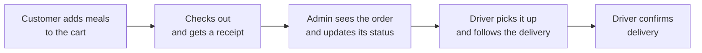

# Foodah! Food Delivery Web App


> A food ordering website with three sides to it: customers order meals, drivers
> deliver them, and administrators manage the menu and the orders.

## In plain terms

**What it is.** A working model of a food delivery service, like the apps you
use to order dinner, built as a website. It was designed around a fictional
brand called *Foodah!*.

**Who uses it and what they can do:**

| If you are… | You can… |
|---|---|
| **A customer** | Browse the menu by category, add meals to a cart, check out, get a receipt, see past orders, update your profile and password |
| **A delivery driver** | See the deliveries assigned to you, follow an order in progress, confirm when it is delivered, set whether you are available |
| **An administrator** | Add, edit and remove menu items and categories, manage drivers, users and other admins, update order status, view an orders report, edit restaurant details |

## How an order flows



## The idea behind the brand

The assignment brief asked for a socially aware service. The Foodah! concept
promotes local and Indigenous food businesses, low-emission delivery by bicycle
and electric scooter, and culturally respectful presentation of dishes, in line
with the AIATSIS Code of Ethics. These are design goals of the concept; features
such as personalised meal recommendations are part of the pitch and are **not**
implemented in this code.

## Technology

| Layer | What is used |
|---|---|
| Web framework | Flask 3 with blueprints (one per area: auth, products, cart, user, driver, admin) |
| Forms and validation | Flask-WTF |
| Database | MySQL through Flask-MySQLdb, with a ready-made sample database (`project/database.sql`) |
| Pages | Jinja2 templates with Bootstrap-Flask |

```plaintext
Food_Delivery_Webapp/
├── run.py               # Starts the app
├── requirements.txt
└── project/
    ├── routes/          # One file per area (admin, auth, cart, driver, ...)
    ├── models/          # Orders, products, carts, users, drivers, restaurants
    ├── forms/           # Form definitions and validation
    ├── templates/       # HTML pages
    ├── static/          # CSS and images
    ├── db.py            # Database queries
    └── database.sql     # Sample data to import
```

## System Prerequisites

1. Python 3.8+
2. MySQL Server
3. MySQL Workbench

## How to Run the Project

1. **Install MySQL Workbench:**

   Download and install MySQL Workbench from the [official MySQL website](https://dev.mysql.com/downloads/workbench/).
2. **Configure MySQL Workbench:**
   - Open MySQL Workbench and create a new connection to your MySQL Server.
   - Use MySQL Workbench to import the pre-populated database schema:
      - Go to `Server` > `Data Import`.
      - Select "Import from Self-Contained File" and choose your `database.sql` file.
      - Select the target schema (e.g., `foodah_database`).
      - Click `Start Import`.
3. **(Optional) Create and activate a virtual environment:**

```bash
   python -m venv venv
   source venv/bin/activate  # On Windows: venv\Scripts\activate
```

4. **Install dependencies:**

   Make sure to install the required libraries using the requirements.txt file

```bash
   # On Windows
   python -m pip install -r requirements.txt

   # On MacOS
   python3 -m pip install -r requirements.txt
```

5. **Configure MySQL Connection:**

Update the MySQL configuration in `project` > `__init__.py` with your MySQL credentials:

```bash
   app.config['MYSQL_USER'] = 'your_mysql_username'
   app.config['MYSQL_PASSWORD'] = 'your_mysql_password'
```

6. **Run the application:**

```bash
   python3 run.py
```

   The app will be available at [http://127.0.0.1:8888](http://127.0.0.1:8888).

## Sample accounts

The sample database comes with a test account for each role (admin, customer and
driver). These are placeholder accounts for a local demo only:

| Role | Email | Password |
|---|---|---|
| System admin | `admin@foodah.com` | `helloworld` |
| Customer | `jamizan@foodah.com` | `helloworld` |
| Delivery driver | `tomasen@foodah.com` | `hello` |

To reset the data, import `project/database.sql` again.

## Status

A university group project (QUT, 2025). It runs locally and is not deployed or
maintained as a product.

## Contributors

- [bajundotdev](https://github.com/bajundotdev)
- [tomsecundo](https://github.com/tomsecundo)
- [raisenx26](https://github.com/raisenx26)
- [danchi-nguyen](https://github.com/danchi-nguyen)
- [JVillanueva08](https://github.com/JVillanueva08)
